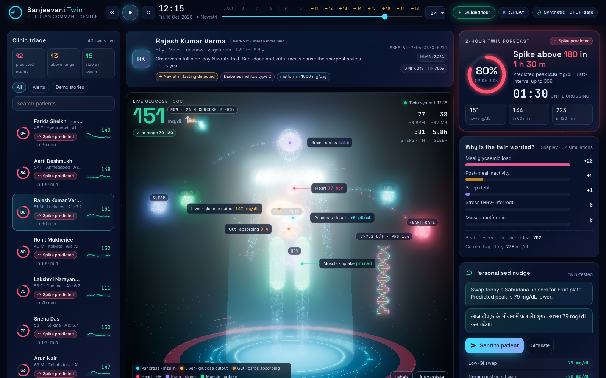
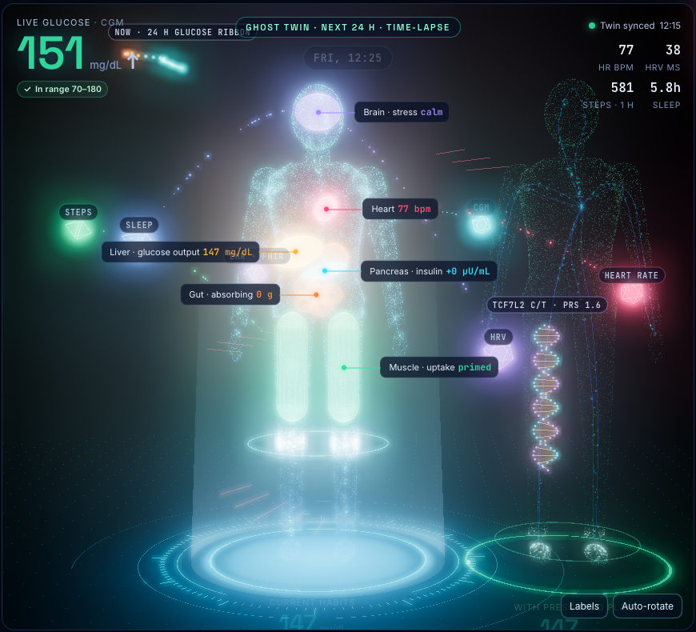
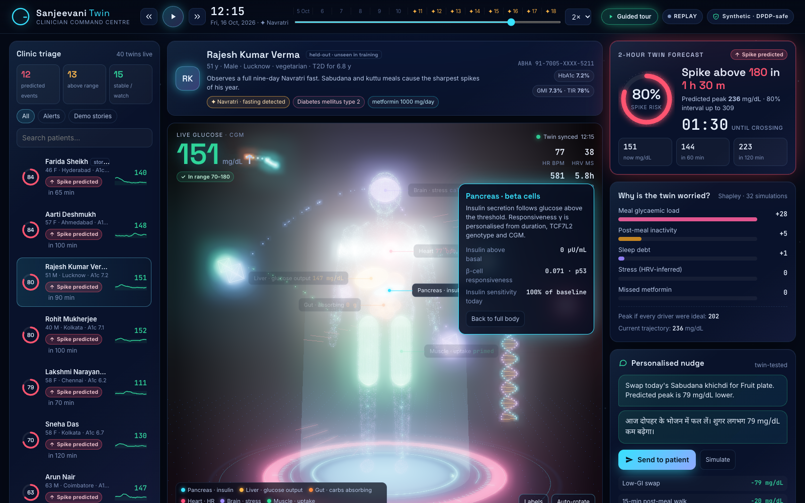
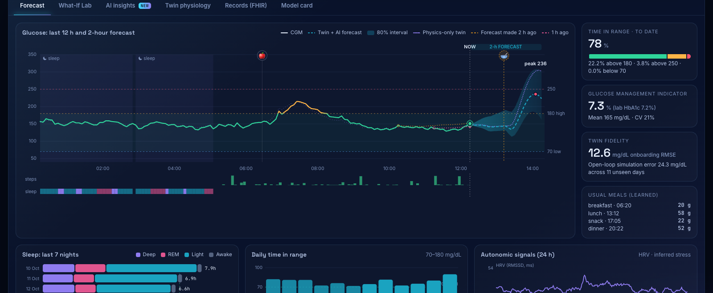
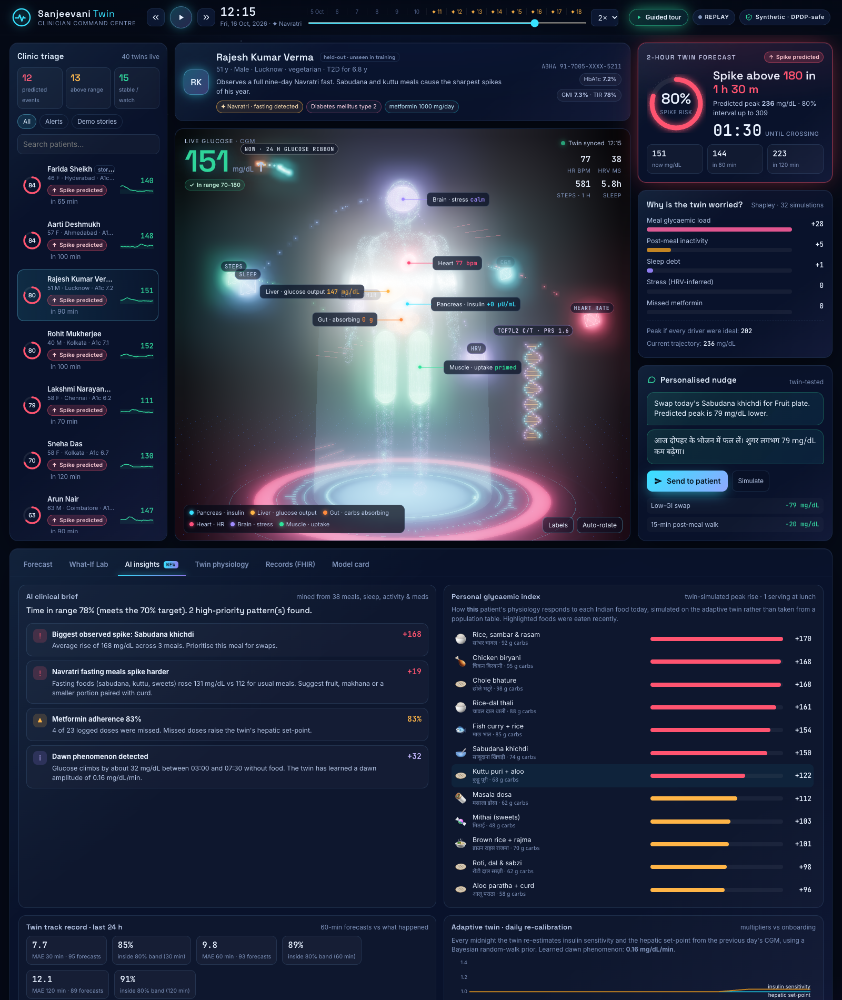

# Sanjeevani Twin

### A hybrid physiology + AI digital twin that predicts Type 2 Diabetes glucose spikes 2 hours ahead, explains them and tests the fix on a virtual patient

**Digital Twin Challenge 2026 · Happiest Health · Reimagining & Reforming Healthcare in India Summit**



[](https://youtu.be/8IZ1PinY-RI)

▶️ **Watch the demo:** https://youtu.be/8IZ1PinY-RI

| | |
|---|---|
| 🎥 **Demo video (≥ 20 min)** | **https://youtu.be/8IZ1PinY-RI** |
| 🧭 **Architecture diagram** | [docs/Architecture_Diagram.pdf](docs/Architecture_Diagram.pdf) |
| 📊 **Presentation** | [docs/Presentation.pdf](docs/Presentation.pdf) |
| ⚖️ **License** | [MIT](LICENSE) for code · CC0 for the synthetic dataset · three.js (MIT) vendored |
| ▶️ **Run it** | `pip install -r requirements.txt && python run.py` → http://127.0.0.1:8000 |

---

## 1. Team details

| | |
|---|---|
| **Team name** | Ayush Upadhyay (solo team) |
| **College** | Vellore Institute of Technology (VIT), Chennai |
| **Team leader** | Ayush Upadhyay |
| **Members** | Ayush Upadhyay |

## 2. Project title

**Sanjeevani Twin: a personalised, hybrid physiology-AI digital twin for Type 2 Diabetes in India**

## 3. Problem statement and healthcare use case

India has about **101 million people with diabetes and 136 million with prediabetes** (ICMR-INDIAB, *Lancet Diabetes & Endocrinology*, 2023). Care is still reactive. HbA1c is checked every three months, while the **post-meal glucose spikes** that drive complications happen daily, between visits, unseen.

Indian physiology and lifestyle also break tools designed elsewhere:
- the **"thin-fat" South-Asian phenotype**: high insulin resistance at a normal BMI
- **rice- and roti-heavy meals** and late dinners
- **festival fasting** (Navratri sabudana and kuttu)
- metformin adherence gaps

**Use case:** a diabetologist or primary-care physician monitors a panel of patients who wear a CGM and a fitness band. For every patient, Sanjeevani maintains a **live digital twin**. It:

1. **Predicts** glucose at 30/60/120 min with calibrated intervals, and the probability of a new spike above 180 mg/dL in the next 2 h, with a countdown.
2. **Explains** each predicted spike with exact Shapley attribution over counterfactual twin simulations (meal load, inactivity, sleep debt, stress, missed dose).
3. **Simulates** interventions before the patient tries them. The *What-If Lab* and *ghost twin* show tomorrow under current habits next to tomorrow under the prescribed plan. An optimiser searches 54 plans.
4. **Acts**: it sends a twin-tested nudge to the patient in English and Hindi, and exports predictions as FHIR resources.

## 4. What makes it a *digital twin* (and not just a predictor)

```
 Static EHR (FHIR R4)  ──► Bayesian priors ─┐
   labs · dx · meds · TCF7L2 · PRS          │
                                            ▼
 Wearables + logs  ──► ingest ──► PERSONAL PHYSIOLOGY (ODE) ◄── nightly re-calibration
   CGM · HR · HRV ·        sleep debt,      glucose · insulin · gut ·        (adaptive twin)
   sleep · steps ·         HRV stress,      exercise · circadian · sleep
   meals · meds            adherence,              │  synced every 5 min by a CGM observer
                           habits, festivals       ▼
                                         HYBRID AI (residual GBMs + conformal + isotonic)
                                                   │
                       ┌───────────────────────────┼───────────────────────────┐
                       ▼                           ▼                           ▼
                Predict (2 h)            Explain (Shapley, 32 sims)   Simulate (what-if, 54 plans)
                       └──────────► 3D clinician dashboard · nudges · FHIR out ◄┘
```

The core is a mechanistic **extended Bergman minimal model** that is personalised per patient:

```
dG/dt = −(S_G + X)·G + S_G·G_b′ + Ra(t) − k_ex·A·G + EGP_stress·s(t) + dawn(t)
dX/dt = −p₂·X + p₂·S_I·m(t)·(1 + 0.8E)·(I − I_b)
dI/dt = −n·(I − I_b) + γ·m(t)·max(G − h, 0)
gut   : parallel fast / slow two-compartment chains (glycaemic-index split per Indian food)
m(t)  = circadian(t) × sleep-debt factor ;  E = exercise memory (τ = 4 h)
```

Because the twin is a simulatable model of *this* patient, it can answer "what if?" questions that a black-box predictor cannot.

## 5. Key features

| Area | Feature |
|---|---|
| **Data fusion** | FHIR R4 EHR (LOINC / SNOMED-CT / RxNorm, Synthea-compatible parser) + CGM, HR, HRV, sleep stages, steps, meal and medication logs |
| **Personalisation** | EHR → Bayesian priors (BMI and waist with South-Asian weighting → S<sub>I</sub>; diabetes duration + **TCF7L2 rs7903146** → β-cell γ; FPG → G<sub>b</sub>; sulfonylurea → threshold) → MAP calibration on 3 onboarding days |
| **Adaptive twin** | Nightly Bayesian re-calibration of insulin sensitivity and hepatic set-point; learned per-patient dawn phenomenon |
| **Wearable intelligence** | Sleep-episode detection → sleep debt; HRV suppression + HR excess → latent stress; missed doses → hepatic effect |
| **India-specific** | 28-food Indian library with GI splits; **festival-aware twin** (detects Navratri fasting and anticipates sabudana meals); Hindi nudges; ABHA-style IDs |
| **Prediction** | Habit-aware twin forecasts + residual quantile GBMs → 30/60/120-min glucose with **conformal 80% intervals**; isotonic-calibrated spike risk |
| **Explainability** | Exact Shapley attribution (2⁵ = 32 counterfactual twin runs) of the predicted peak |
| **Simulation** | What-If Lab (walk, low-GI swap, earlier dinner, sleep, metformin), 54-plan prescription search, 90-day HbA1c projection |
| **3D twin** | Particle body that assembles itself; organs glow from live state; glucose-coloured blood; heartbeat shockwaves; **24-h 3D glucose ribbon**; DNA helix for genotype; data streams fusing in; click-to-focus organs; **ghost twin** showing two futures side by side |
| **AI insights** | Personal glycaemic index (every food simulated on this patient), mined clinical brief, the twin's own track record, adaptive drift |
| **Interoperability** | FHIR export: `RiskAssessment` + forecast `Observation`s + `Communication` (nudge) |
| **Trust** | Held-out validation, 4 baselines, Clarke error grid, reliability diagram, data-efficiency curve, leak-proof unit test, visible past forecasts |
| **Demo** | One-click **Guided tour** for judges (press `T`), 14-day replay with play/scrub |

<table><tr>
<td><br><sub><b>Ghost twin</b>: the next 24 h on current habits (left) vs the plan (right)</sub></td>
<td><br><sub><b>Click-to-focus</b>: personalised pancreas parameters</sub></td>
</tr><tr>
<td><br><sub><b>Forecast</b>: cone, physics line and past forecasts against reality</sub></td>
<td><br><sub><b>AI insights</b>: clinical brief and personal glycaemic index</sub></td>
</tr></table>

## 6. Results (10 held-out patients · 108 patient-days · never seen in training)

| Model | RMSE 30 min | 60 min | 120 min | MARD 2 h | Clarke A+B 2 h | Spike AUROC | False alerts / day |
|---|---|---|---|---|---|---|---|
| Persistence | 26.6 | 42.6 | 52.8 | 21.4% | 92.6% | — | — |
| Linear trend | 31.2 | 62.3 | 101.3 | 46.2% | 78.0% | 0.546 | — |
| Physics twin only | 16.8 | 29.6 | 34.4 | 12.1% | 97.6% | 0.801 | 0.85 |
| ML only (no twin) | 15.0 | 24.1 | 28.1 | 10.9% | 99.0% | 0.896 | 0.88 |
| **Sanjeevani hybrid** | **13.7** | **22.9** | **27.6** | **10.1%** | **99.0%** | **0.905** | **0.65** |

- **48% lower 2-h error than persistence**; Clarke zone A 86.4%, A+B 99.0%.
- **Spike warning:** median **105 min** before a real crossing of 180 mg/dL (457 events). Alert threshold = the most sensitive setting with ≥ 75% precision on calibration patients. At that setting the hybrid reaches **82% precision vs 79%** for ML-only, with **26% fewer false alarms**.
- **Calibrated:** conformal intervals cover 76–78% (nominal 80%); spike-probability ECE 0.06.
- **Data efficiency:** trained on only 2 patients, the hybrid's 2-h RMSE is **31.3 vs 38.1** (ML-only), **18% lower**. The physics twin alone scores 34.4 with **zero** training patients, so it can start at a new clinic on day one.
- **The twin is the backbone:** removing its forecasts drops AUROC by 0.154, about 8× more than any wearable group alone.
- **Personalisation is real:** correlation with each patient's hidden physiology rises from EHR prior to calibrated twin. Insulin sensitivity goes 0.76 → 0.89, β-cell function 0.65 → 0.83, basal glucose 0.86 → 0.98.

All numbers are regenerated by `python -m sanjeevani.pipeline` and saved to [`models/metrics.json`](models/metrics.json).

### Why the evaluation is honest
- **The ground truth includes effects the twin cannot see:** dawn phenomenon, unlogged snacks, ±22% carb-estimation error, day-to-day insulin-sensitivity drift, latent stress (the twin sees only HRV/HR) and CGM lag, noise, drift and dropouts.
- **Patient-level split:** 24 train, 6 calibration (conformal offsets, isotonic calibration, thresholds) and 10 test. All six demo personas are test patients.
- **Strictly causal features:** `tests/test_sanjeevani.py::test_features_are_causal` corrupts every signal after the prediction time, at daytime and mid-sleep anchors, and asserts that no feature changes.

## 7. Technical stack and AI/ML details

| Layer | Technology |
|---|---|
| Language / runtime | Python 3.10+ (tested on 3.14), CPU-only |
| Numerics / ML | NumPy (vectorised ODE engine: thousands of futures per call), SciPy, pandas, **scikit-learn** (HistGradientBoosting quantile regressors + classifier, isotonic regression, logistic baseline) |
| Twin calibration | MAP cross-entropy search (384 candidates × 3 rounds, batched), lag-compensated CGM state observer, nightly random-walk Bayesian adaptation |
| Uncertainty | Conformalized quantile regression (Romano et al., 2019) on disjoint calibration patients |
| Explainability | Exact Shapley values over 32 counterfactual twin simulations; grouped permutation importance |
| Interoperability | FHIR R4 in/out; LOINC, SNOMED-CT, RxNorm; ABHA-style identifiers |
| API | Python standard-library HTTP server (`/api/cohort`, `/patient`, `/whatif`, `/optimise`, `/insights`, `/fhir`, `/fhir-out`, `/metrics`) |
| Frontend | Vanilla JS + hand-built animated SVG charts; **three.js r160** (vendored, works offline) with custom GLSL shaders, UnrealBloom post-processing, OrbitControls |
| Tests | `unittest`: physiology sanity, metrics, FHIR parsing, calibration recovery, causality |

**Models in detail**
- *Inputs (52 causal features)*: the twin's habit-aware and no-meal forecasts at 30/60/120 min; predicted peak and its timing; the twin's state vector (glucose, insulin action, gut contents, exercise memory); the twin's own recent forecast errors; the adaptive insulin-sensitivity multiplier; CGM level and trends; logged and expected carbs; steps; HRV and HR-derived stress; sleep hours, deep fraction and debt; circadian phase; weekend; EHR, genetics and medications.
- *Targets*: residual (CGM − twin) at each horizon for quantiles 0.1/0.5/0.9; binary new excursion above 180 within 2 h from below 160.
- *Baselines*: persistence, linear trend, physics twin only, and the same GBM without any twin features.

## 8. Data (sandbox rules)

No real patient data is used. The generator (`sanjeevani/synth`) creates **40 synthetic Indian adults with T2D × 14 days (5 to 18 Oct 2026, spanning Navratri)**:
- **EHR**: FHIR R4 bundles with HbA1c history, FPG, lipids, eGFR, UACR, BP, BMI, waist, diagnoses, medications, TCF7L2 genotype, polygenic risk score, family history and a masked ABHA-style ID. Everything is tagged `SYNTHETIC`.
- **Wearables**: CGM (5-min, with 10-min lag, AR(1) noise, drift, dropouts), heart rate, HRV (RMSSD), sleep stages, steps.
- **Logs**: meals from the Indian food library (≈ 75–90% logged, with portion-estimation error); metformin doses with adherence.
- **Behaviour**: four regional cuisines, weekend biryani, late IT-shift dinners, Navratri fasting, work stress, post-meal walking habits.
- Hidden ground truth (for evaluation only) is in `data/_ground_truth/`. The twin never reads it.

The FHIR ingest (`sanjeevani/ingest/fhir.py`) accepts **Synthea** bundles, and the stream format mirrors Apple Health / Google Fit exports. The natural next step is validation on open CGM datasets such as PhysioNet BIG IDEAs.

## 9. Quick start

```bash
git clone <this repo> && cd <repo>
pip install -r requirements.txt        # numpy, scipy, pandas, scikit-learn
python run.py                          # opens http://127.0.0.1:8000
```

The data and trained models are included, so the dashboard starts in about a second. If your scikit-learn version cannot load the saved models, `run.py` retrains automatically (~5–7 min on a laptop CPU).

```bash
python run.py --rebuild                # regenerate data + recalibrate twins + retrain + evaluate
python -m sanjeevani.pipeline          # training + evaluation report only
python -m unittest discover -s tests   # tests
./scripts/build_docs.sh                # re-render screenshots and PDFs (server running, Chrome installed)
```

**Using the dashboard:** click **Guided tour** (or press `T`). `Space` plays the 14-day replay, `← / →` steps 15 min, click any organ to focus and `Esc` resets. Try *What-If Lab → Find the best plan* to see the ghost twin.

## 10. Repository structure

```
├── run.py                      one-command launcher
├── sanjeevani/
│   ├── physiology.py           vectorised glucose-insulin ODE (batch of thousands of futures)
│   ├── foods.py                Indian food library (carbs, GI split, Hindi names)
│   ├── synth/                  synthetic cohort: population, behaviour + sensors, FHIR EHR
│   ├── ingest/fhir.py          FHIR R4 → clinical profile (Synthea-compatible)
│   ├── twin/
│   │   ├── patient.py          streams → twin inputs (sleep, stress, adherence, habits)
│   │   ├── core.py             priors, calibration, assimilation, adaptive twin, forecasts
│   │   ├── scenarios.py        Shapley attribution, what-if, plan optimiser
│   │   └── insights.py         personal glycaemic index, clinical brief
│   ├── ml/                     causal features, clinical metrics (Clarke, AUROC, lead time)
│   ├── pipeline.py             training + held-out evaluation + data-efficiency study
│   └── api/                    engine + stdlib HTTP server
├── dashboard/                  3D holographic UI (three.js, SVG charts)
├── data/                       synthetic cohort (FHIR + CSV) and hidden ground truth
├── models/                     trained models, twin states, metrics.json
├── docs/                       Architecture_Diagram.pdf, Presentation.pdf, VIDEO_SCRIPT.md, images
└── tests/
```

## 11. Impact and roadmap

- **Clinicians** triage by foresight instead of hindsight. **Patients** get small, culturally fitting, twin-tested nudges. **Health systems** get FHIR/ABHA-ready, CPU-only software that suits primary health centres.
- **Next steps**: retrospective validation on open CGM datasets; a silent-mode pilot with a diabetes clinic; hypertension and cardiovascular-risk twins on the same engine; regional languages and voice nudges via ASHA workers.

## 12. Responsible AI and limitations

This is a research prototype, **not a medical device**. It never doses insulin. Synthetic physiology is not a substitute for clinical validation, and real-world performance will be lower than on simulated data. Uncertainty is shown with every forecast, and the full validation is visible in the *Model card* tab.

## 13. License

Code: [MIT](LICENSE). Synthetic dataset: CC0 1.0. three.js r160: MIT (vendored in `dashboard/vendor/three`).
